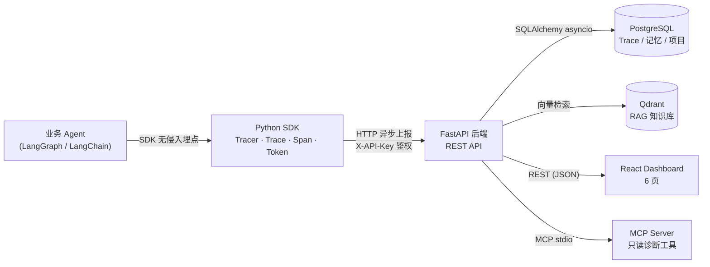
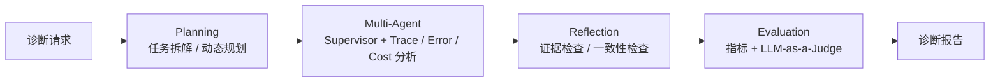
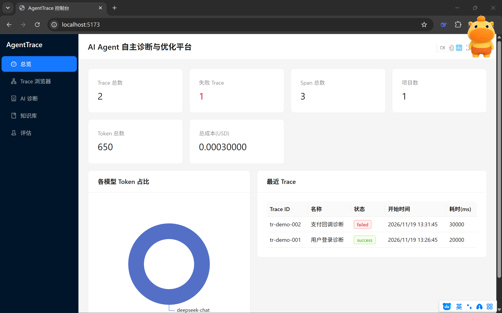
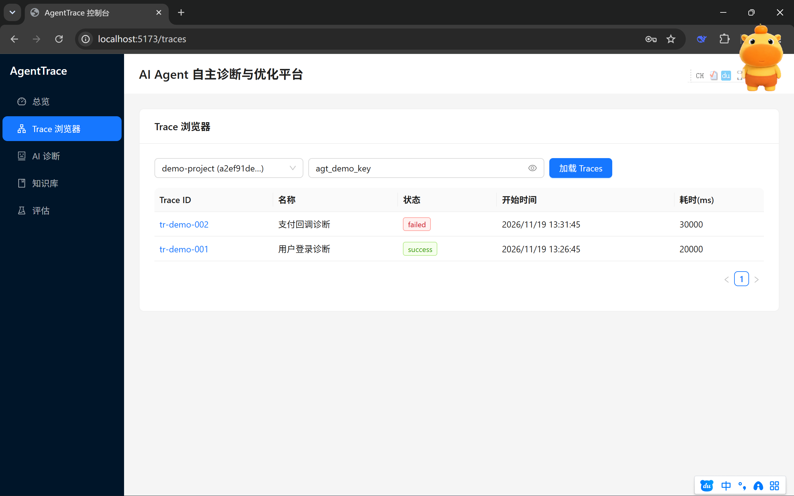
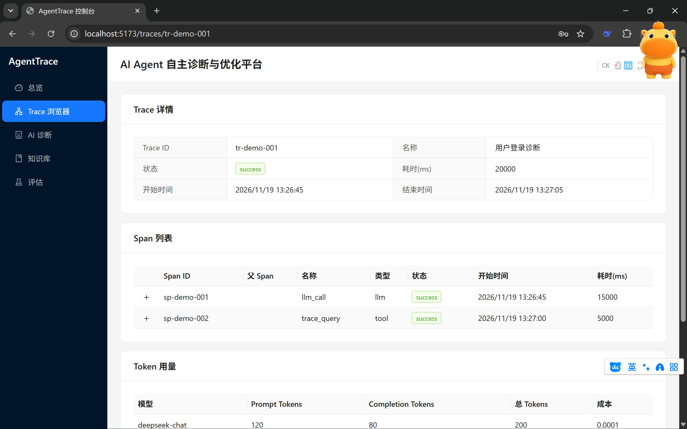
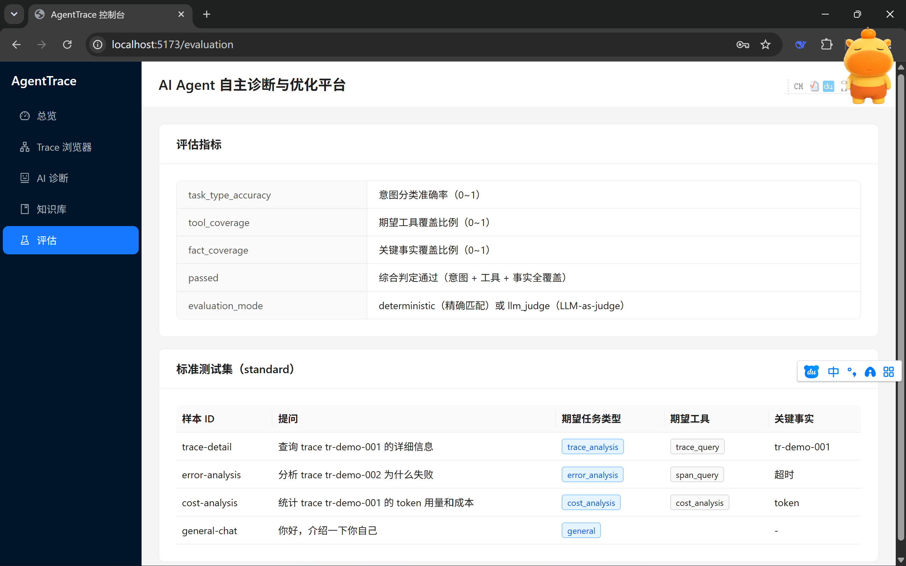
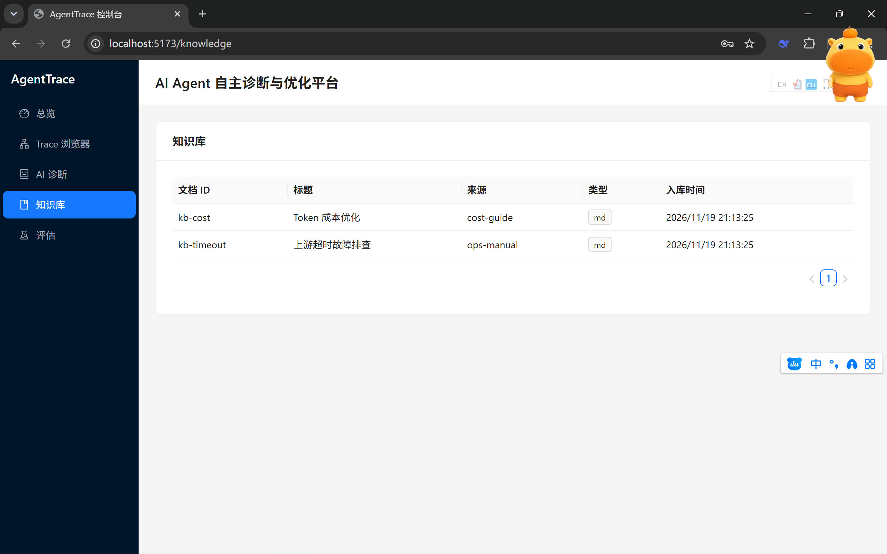

# AgentTrace（Python 版）

基于 Multi-Agent 的 **AI Agent 自主诊断与优化平台**。

> An Autonomous AI Agent Observability and Diagnosis Platform.
> 核心理念：让 AI Agent 不仅「观察」另一个 Agent，还能「理解、诊断、并帮助它变得更好」。


## 项目状态

✅ **M0~M8 已全部完成**（见 [docs/PROJECT_STATUS.md](docs/PROJECT_STATUS.md)）。

## 系统架构



## 诊断流水线



四个阶段各司其职：

1. **Planning**：把「这个 Agent 出了什么问题」拆成可执行的诊断步骤，支持条件路由与动态规划。
2. **Multi-Agent**：Supervisor 协调多个分析 Agent（Trace 分析、错误分析、成本分析）+ Report Agent 汇总。
3. **Reflection**：对每条结论做证据检查（`SUPPORTED / MISSING / CONTRADICTED / UNVERIFIABLE`）与一致性检查，必要时有限重分析。
4. **Evaluation**：自动化评估（task_type_accuracy / tool_coverage / fact_coverage）+ LLM-as-a-Judge。

## 界面预览

| 页面 | 说明 |
|---|---|
| 总览 | 全局指标、模型 Token 占比、最近 Trace |
| Trace 浏览器 | 按项目 + API Key 查询 Trace 列表 |
| Trace 详情 | spans + token 用量 |
| 评估 | 标准测试集与指标 |
| 知识库 | 知识库文档列表 |











## 技术栈

Python 3.12 · LangGraph · LangChain · FastAPI · SQLAlchemy(asyncio) · PostgreSQL · Qdrant · MCP · React 18 + TypeScript + Vite + Ant Design + ECharts · Docker

## 核心能力

- **采集（SDK）**：`sdk/agenttrace/` 无侵入埋点，采集 Trace / Span / Token 用量，异步 HTTP 上报（API Key 鉴权，服务端只存哈希）。
- **诊断（Multi-Agent）**：Planning → Multi-Agent（Supervisor + Trace/Error/Cost 分析 + Report Agent）→ Reflection → Evaluation。
- **检索（RAG + 记忆）**：Qdrant 向量检索（RAG）+ PostgreSQL 长期记忆（Episodic / Semantic / Procedural，含语义去重与巩固）。
- **反思与评估**：证据检查、一致性检查、有限重分析；标准测试集 + 自动化评估 + LLM-as-a-Judge。
- **开放（REST + MCP）**：REST API 供 SDK / Dashboard 使用；MCP Server 把只读诊断工具开放给其他 Agent。
- **展示（Dashboard）**：React Dashboard 六页（总览 / Trace 浏览器 / Trace 详情 / AI 诊断 / 知识库 / 评估）。

## 技术亮点

- **安全鉴权**：API Key 用 sha256 哈希存储 + `secrets.compare_digest` 常数时间比较，服务端不存明文（ADR-0007）。
- **无侵入埋点**：SDK 通过 contextvars 自动挂父子 Span，业务代码零改动即可采集 Trace / Span / Token，异步 HTTP 上报（ADR-0006）。
- **语义单源**：MCP Server 复用 M1 的 LangChain 工具实现，REST / MCP / 内部工具返回同一套 JSON 语义。
- **Human-in-the-loop**：Memory 的 Working 图通过 LangGraph `interrupt` / `Command(resume)` 在关键节点人工确认（ADR-0004）。
- **语义记忆**：Episodic → Semantic 的 LLM 巩固（`distill` 注入点隔离 LLM），语义检索 + 去重。
- **证据可追溯**：Reflection 对每条结论做证据检查（`SUPPORTED / MISSING / CONTRADICTED / UNVERIFIABLE`）。

## 目录结构

```
agenttrace/
├── backend/            FastAPI 应用（agents / api / core / rag / memory / reflection / evaluation / repositories / models / schemas / tools）
│   └── alembic/        数据库迁移
├── sdk/agenttrace/     Python SDK（Tracer / Trace / Span / TraceCallbackHandler / HTTPExporter）
├── mcp_server/         MCP Server（只读诊断工具）
├── frontend/           React Dashboard（Vite + AntD + ECharts）
├── scripts/            演示脚本（seed / sdk_demo / mcp_client_demo / diagnose / memory / reflection / eval 等）
├── docs/               项目规划 + 开发进度
├── docker-compose.yml  一键部署
└── pyproject.toml      uv 项目配置
```

## 快速开始（本地开发）

```bash
# 1. 安装依赖
uv sync

# 2. 配置环境变量（复制示例并填入真实 Key）
cp .env.example .env

# 3. 启动依赖（PostgreSQL + Qdrant，可用 Docker）
docker compose up -d postgres qdrant

# 4. 执行数据库迁移
uv run python -m alembic -c backend/alembic.ini upgrade head

# 5. （可选）写入演示数据
uv run python scripts/seed_demo_data.py

# 6. 启动后端
uv run python -m uvicorn backend.app.main:app --reload

# 7. 启动前端 Dashboard（另开终端）
cd frontend && npm install && npm run dev
```

- 后端：http://localhost:8000（OpenAPI 文档 http://localhost:8000/docs）
- 前端：http://localhost:5173

## 使用教程

> 前置：先完成上方「快速开始」的 1~5 步（服务已启动、演示数据已写入）。AI 诊断与知识库步骤需要配置对应 API Key（见「环境变量」）。

### 1. 创建接入项目，获取 API Key

```bash
curl -X POST http://localhost:8000/projects \
  -H "Content-Type: application/json" \
  -d '{"name": "my-agent-project"}'
```

返回（`api_key` 仅此一次返回，请妥善保存）：

```json
{"project_id": "<uuid>", "name": "my-agent-project", "api_key": "agt_..."}
```

### 2. 用 SDK 无侵入采集 Trace

```python
from sdk.agenttrace import AgentTraceClient, Tracer, TraceCallbackHandler

client = AgentTraceClient(
    endpoint="http://localhost:8000",
    api_key="<上一步的 api_key>",
    project_id="<上一步的 project_id>",
)
tracer = Tracer(client)
handler = TraceCallbackHandler(tracer)

with tracer.trace("外部 Agent 诊断") as trace:
    with tracer.span("agent_run", span_type="chain"):
        await agent.ainvoke(
            {"messages": [("user", "查询 tr-demo-001 详情")]},
            config={"callbacks": [handler]},
        )

await client.flush(trace)  # 异步上报
```

完整可运行示例：`scripts/sdk_demo.py`。

### 3. 在 Dashboard 查看 Trace

打开 http://localhost:5173 →「Trace 浏览器」：选择项目、填 API Key、点「加载 Traces」；点击 Trace ID 进入详情，查看 spans / token / 成本。

### 4. AI 诊断

```bash
# 单 Agent 诊断（M1）
uv run python scripts/diagnose.py "查询 trace tr-demo-001 的详情"

# Multi-Agent 综合诊断（M3）
uv run python scripts/diagnose_multi.py "全面分析 demo-project 的健康状况"
```

或通过 REST API：

```bash
curl -X POST http://localhost:8000/diagnose \
  -H "Content-Type: application/json" \
  -d '{"query": "分析失败率最高的 trace"}'
```

### 5. 知识库（RAG）

```bash
docker compose up -d qdrant
uv run python scripts/ingest_knowledge.py
```

把演示知识文档切分、向量化写入 Qdrant，后续诊断可检索知识库增强回答。

### 6. 通过 MCP 开放诊断工具

```bash
# 启动 MCP Server（stdio）
uv run python -m mcp_server.server

# MCP Client 冒烟
uv run python scripts/mcp_client_demo.py
```

把 `trace_query` / `span_query` / `cost_analysis` 三个只读工具以 MCP 协议开放给任意 MCP Client。

## Docker Compose 一键部署

```bash
cp .env.example .env   # 填入真实 API Key
docker compose up -d --build
```

启动后：

| 服务 | 地址 |
|---|---|
| Dashboard | http://localhost:8080 |
| 后端 API | http://localhost:8000 |
| PostgreSQL | localhost:5432 |
| Qdrant | http://localhost:6333 |

后端容器启动时自动执行 Alembic 迁移，无需手动建表。

## REST API

| 方法 | 路径 | 鉴权 | 说明 |
|---|---|---|---|
| GET | `/health` | 无 | 健康检查 |
| GET | `/projects` | 无 | 列出项目 |
| POST | `/projects` | 无 | 创建项目（返回一次性 API Key） |
| POST | `/ingest/trace` | `X-API-Key` | SDK 上报一条 Trace |
| GET | `/traces` | `X-API-Key` | 列出项目下 Trace |
| GET | `/traces/{trace_id}` | `X-API-Key` | Trace 详情（spans + token + 成本） |
| GET | `/overview` | 无 | 全局指标聚合 |
| POST | `/diagnose` | 无 | AI 综合诊断（Multi-Agent） |
| GET | `/knowledge` | 无 | 列出知识库文档 |
| GET | `/evaluation/dataset` | 无 | 标准测试集与指标 |

> `POST /projects` 返回的一次性明文 API Key 用于 SDK 上报与 `/traces` 查询；服务端只存哈希。

## SDK 使用

```python
from sdk.agenttrace import AgentTraceClient, Tracer, TraceCallbackHandler

client = AgentTraceClient(
    endpoint="http://localhost:8000", api_key="<创建项目返回的 Key>", project_id="<project_id>"
)
tracer = Tracer(client)
handler = TraceCallbackHandler(tracer)

with tracer.trace("外部 Agent 诊断") as trace:
    with tracer.span("agent_run", span_type="chain"):
        await agent.ainvoke(
            {"messages": [("user", "查询 tr-demo-001")]}, config={"callbacks": [handler]}
        )

await client.flush(trace)
```

完整示例见 `scripts/sdk_demo.py`。

## MCP 使用

把只读诊断工具（`trace_query` / `span_query` / `cost_analysis`）以 MCP 协议开放：

```bash
# MCP Server（stdio，供 MCP Client 以子进程方式拉起）
uv run python -m mcp_server.server

# 官方 MCP Client 冒烟（需先 seed 演示数据）
uv run python scripts/mcp_client_demo.py
```

工具与 M1 的 LangChain 工具语义一一对应，返回同样的 JSON。详见 [mcp_server/README.md](mcp_server/README.md)。

## 测试与代码质量

```bash
uv run ruff check                        # 静态检查（lint）
uv run pytest                            # 单元 + 集成测试
uv run mypy                              # 类型检查
uv run pre-commit run --all-files        # 提交前检查
```

| 项 | 结果 |
|---|---|
| pytest | ✅ 79 passed |
| ruff | ✅ All checks passed |
| mypy | ✅ 0 errors（133 files） |
| 前端构建 | ✅ `npm run build` 通过（6 页面 chunk + 3 vendor chunk） |

## 环境变量

见 [.env.example](.env.example)。关键项：

- `DEEPSEEK_API_KEY` / `DEEPSEEK_BASE_URL` / `DEEPSEEK_MODEL` — 诊断 LLM
- `SILICONFLOW_API_KEY` / `SILICONFLOW_EMBEDDING_MODEL` — Embedding（RAG）
- `POSTGRES_*` — 数据库连接
- `QDRANT_URL` — 向量库

## 文档

- 项目规划：[docs/00-项目规划/](docs/00-项目规划/)
- 开发进度：[docs/PROJECT_STATUS.md](docs/PROJECT_STATUS.md)

## License

[MIT](LICENSE) © 2026 LIHANYU
